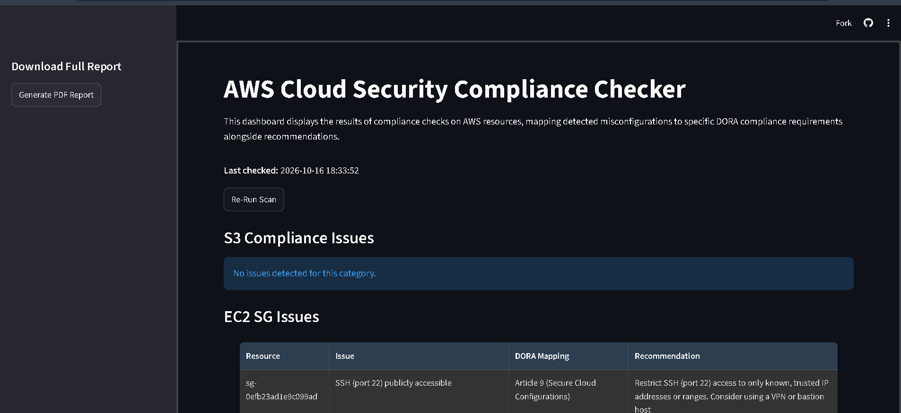
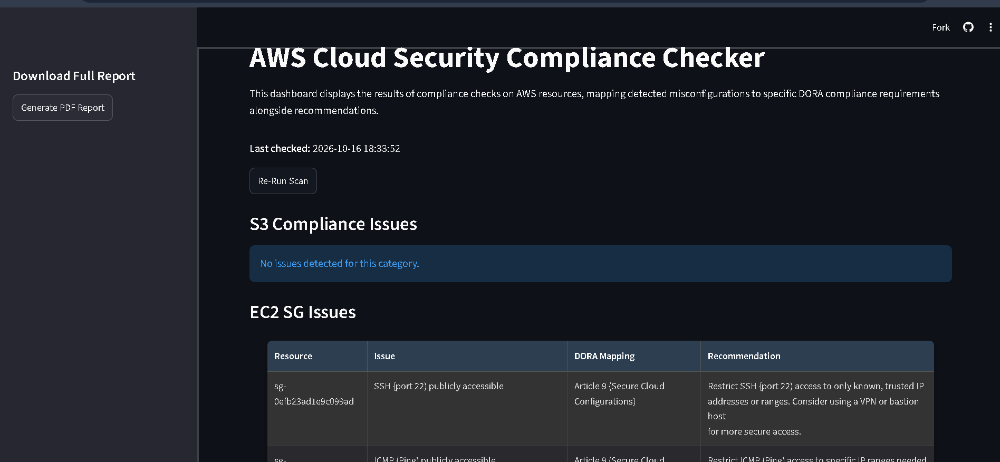
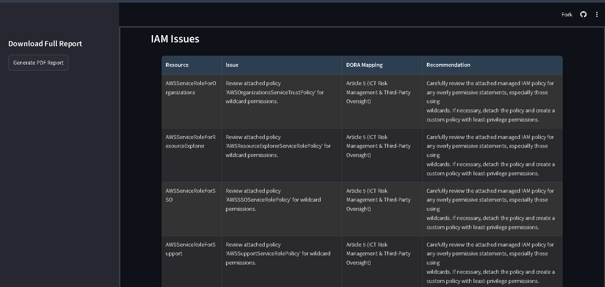
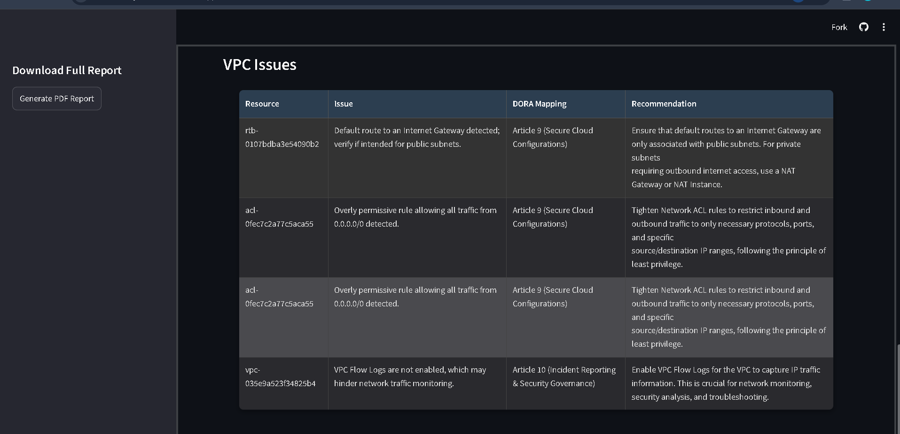
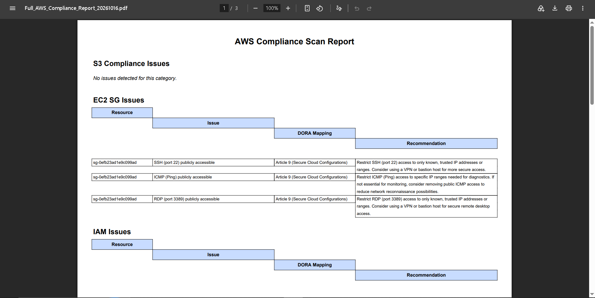
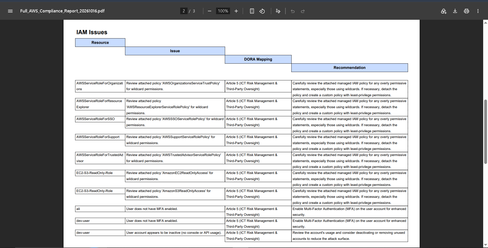
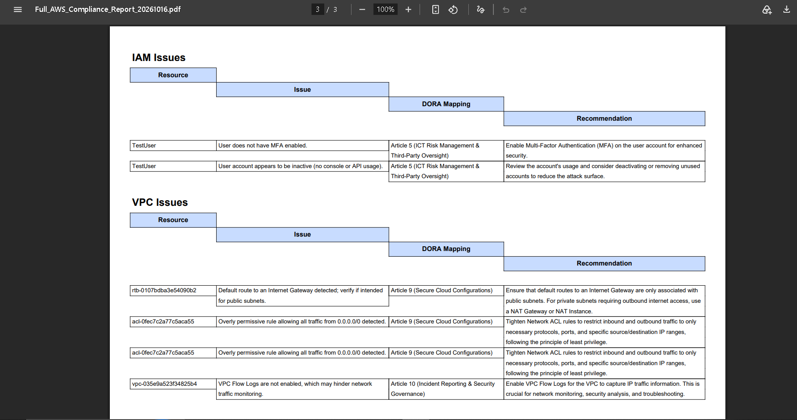

# AWS Cloud Security Compliance Checker
 [](https://www.python.org/downloads/)

## **Overview**

Welcome to the **AWS Cloud Security Compliance Checker**! This project is designed to assist financial institutions (and any AWS user) in identifying security misconfigurations and ensuring compliance with the **Digital Operational Resilience Act (DORA)**. The tool scans key AWS services, Amazon S3, EC2 Security Groups, IAM Policies, and VPC Configurations, for potential vulnerabilities. Results are presented through an interactive **Streamlit frontend dashboard**, allowing users to review findings in real-time and export **PDF compliance reports** with remediation recommendations.

---

## Project Components

- **`checker.py`**: A Python script using the `boto3` SDK to connect to AWS and detect misconfigurations.
- **`streamlit.py`**: An interactive web frontend dashboard built with Streamlit, displaying compliance scan results and offering one-click PDF report generation.
- **`.env` file**: Stores AWS resource identifiers (e.g., VPC ID, subnet IDs) securely for local use (not uploaded to GitHub).
- **PDF Reporting**: Generates a detailed audit-ready report summarizing misconfigurations and their DORA mappings.

---

## 📸 **Live Demo & Screenshots**


### **1. Live Dashboard Overview**


*Interactive web dashboard displaying real-time security posture across AWS resources.*


---

### **2. Security Misconfiguration Scan Results**
<!-- Replace with your S3, EC2, IAM, or VPC scan results screenshot (e.g., assets/screenshots/scan-results.png) -->




*Automated scanning and detection of vulnerabilities across Amazon S3, EC2, IAM, and VPC.*

---

### **3. Generated PDF Compliance Report**
*Executive PDF compliance report ready for audit review and export.*





---

## **AWS Environment Setup**

To test this tool, a specific AWS environment was created with deliberate vulnerabilities.

### **1. AWS Services Created**
- **Amazon S3 Bucket**: Configured to test public access, encryption, and logging settings.
- **Amazon EC2 Instance**: Paired with a security group exposing ports like SSH (22) and RDP (3389).
- **AWS IAM Users/Roles**: Set up to evaluate overly permissive policies and MFA usage.
- **Amazon VPC**: Includes subnets, route tables, and network ACLs to assess network security.

### **2. Deliberately Introduced Vulnerabilities**
- **S3 Buckets:**
    - Public access enabled.
    - No encryption configured.
    - Logging disabled.
- **EC2 Security Groups:**
    - Inbound rules allow SSH (port 22) and RDP (port 3389) from any IP (`0.0.0.0/0`).
    - Added unrestricted ingress rules (`0.0.0.0/0`, not a good idea in real life!).
- **IAM Policies:**
    - Roles with policies that use wildcards (e.g., `"Action": "*", "Resource": "*"`) representing overly broad permissions.
    - Some IAM users are set up without MFA.
- **VPC Configurations:**
    - Route tables include a default route to an Internet Gateway.
    - Network ACLs are configured to allow all traffic (`0.0.0.0/0`).
    - Subnets are set to automatically assign public IP addresses.
    - VPC Flow Logs are not enabled.

These intentional flaws help demonstrate the tool's ability to detect and report security misconfigurations.

---

## **Setting Up Your Development Environment in VS Code**

### **1. Install Visual Studio Code**
If you don’t have VS Code, download and install it from [here](https://code.visualstudio.com/).

### **2. Clone the Repository**
Open a terminal in VS Code (<kbd>Ctrl</kbd>+<kbd>`</kbd>) and run:
```
git clone https://github.com/rajsenyadav/-aws-security-posture-analyzer.git
cd -aws-security-posture-analyzer
```

### **3. Set Up a Virtual Environment**

Create a virtual environment to manage dependencies:

```
python -m venv venv
```

Now, activate it:

- **macOS/Linux**:

```
source venv/bin/activate
```

- **Windows**:

```
venv\Scripts\activate
```

You should see `(venv)` in your terminal, indicating that the environment is active.

### **4. Install Dependencies**
Install required packages:
```
pip install -r requirements.txt
```
This installs boto3, streamlit, and few packages used.

---

## **Configuring Your AWS Environment**

### **1. Install and Configure AWS CLI (Local Only)**
Install the AWS CLI ([instructions](https://docs.aws.amazon.com/cli/latest/userguide/getting-started-install.html)) and configure it:
```
aws configure
```
You’ll need to provide:
- AWS Access Key ID
- AWS Secret Access Key
- Default region (e.g., `eu-north-1`)
- Default output format: Just hit Enter for JSON (the default).

### **2. Create AWS Resources**
Set up your AWS resources as follows:

- **S3 Bucket**: Create a bucket (e.g., `my-security-test-bucket`) and deliberately configure it with public access, no encryption, and disabled logging.
- **EC2 Instance**: Launch an instance (t2.micro is sufficient) with a security group that has open ports for SSH (22) and RDP (3389) with ingress rules set to `0.0.0.0/0`.
- **IAM Users/Roles**: Create a user or role with overly permissive policies (using `"Action": "*", "Resource": "*"`). Omit MFA for some users.
- **VPC**: Set up a VPC with a public subnet (auto-assign public IP enabled), an Internet Gateway attached, a route table with a default route to the IGW, and a permissive Network ACL. Do not enable VPC Flow Logs.

Keep a note of all resource IDs (e.g., VPC ID, subnet IDs, route table ID, IGW ID, ACL ID).
### **3. Set Up Environment Variables (Local Only)**
Create a `.env` file in the project root:
```
touch .env
```
Add:
```
AWS_VPC_ID=vpc-xxxxxxxxxxxxxxxxx
AWS_PUBLIC_SUBNET_ID=subnet-xxxxxxxxxxxxxxxxx
AWS_PRIVATE_SUBNET_ID=subnet-xxxxxxxxxxxxxxxxx
AWS_ROUTE_TABLE_ID=rtb-xxxxxxxxxxxxxxxxx
AWS_IGW_ID=igw-xxxxxxxxxxxxxxxxx
AWS_PERMISSIVE_ACL_ID=acl-xxxxxxxxxxxxxxxxx
```
Replace the xs with your actual AWS resource IDs from the setup above. This keeps everything tidy and secure.

---

## **Running the Compliance Scanner (Streamlit Frontend)**

### **1. Launch Locally**
Start the interactive Streamlit frontend web dashboard with:

```bash
streamlit run streamlit.py
```

It will launch a local web server (typically at `http://localhost:8501`). Open that URL in your browser to inspect interactive tables, trigger re-scans, and download PDF reports.

---

## **Deployment & Configuration**

### **1. Repository Configuration**
- The GitHub repo (`rajsenyadav/-aws-security-posture-analyzer`) contains `checker.py`, `streamlit.py`, and `requirements.txt`.
- Sensitive data (credentials, resource IDs) is excluded via `.gitignore`.

### **2. Environment Variables in Streamlit Cloud**
- AWS credentials and resource IDs are stored as environment variables in Streamlit Cloud’s **Settings**:
  - `AWS_ACCESS_KEY_ID`
  - `AWS_SECRET_ACCESS_KEY`
  - `AWS_VPC_ID`
  - `AWS_PUBLIC_SUBNET_ID`
  - `AWS_PRIVATE_SUBNET_ID`
  - `AWS_ROUTE_TABLE_ID`
  - `AWS_IGW_ID`
  - `AWS_PERMISSIVE_ACL_ID`

## **How the Code Works**

### **Code Functionality**
- **AWS Resource Scanning**: `checker.py` uses `boto3` to retrieve configurations from S3, EC2, IAM, and VPC.
- **Security Checks**:
  - S3: Public access, encryption, logging.
  - EC2 Security Groups: Open ports (SSH, RDP, HTTP), wide-open rules.
  - IAM: Wildcard permissions, inactive users, missing MFA.
  - VPC: Internet Gateway routes, permissive ACLs, public subnets, Flow Logs.
- **Compliance Mapping**: Misconfigurations are mapped to DORA Articles (e.g., Article 9 for secure configurations, Article 5 for access management) using hardcoded rules.


## **Project Structure**

```
-aws-security-posture-analyzer/
│-- assets/
│   └── screenshots/  # Live demo and report photos
│-- .gitignore        # Keeps sensitive files out of Git
│-- .env              # AWS resource IDs (not in this repo)
│-- requirements.txt  # List of Python dependencies
│-- README.md         # Project documentation (this file)
│-- checker.py        # The scanner script
│-- streamlit.py      # The dashboard code
│-- venv/             # Virtual env (not in this repo)
│-- __pycache__/      # Compiled Python files (ignored)
```

---

## **Credits**

Developed by: [@rajsenyadav](https://github.com/rajsenyadav)  
Repository: [https://github.com/rajsenyadav/-aws-security-posture-analyzer.git](https://github.com/rajsenyadav/-aws-security-posture-analyzer.git)
